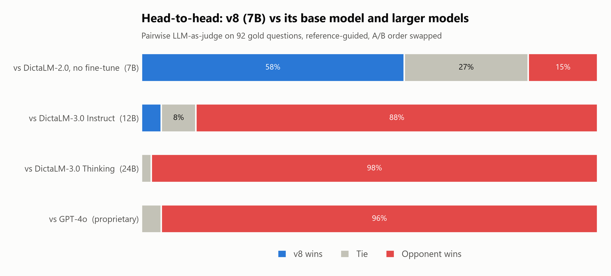
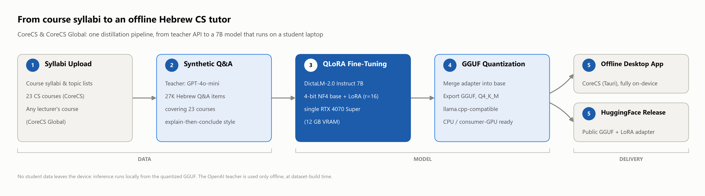
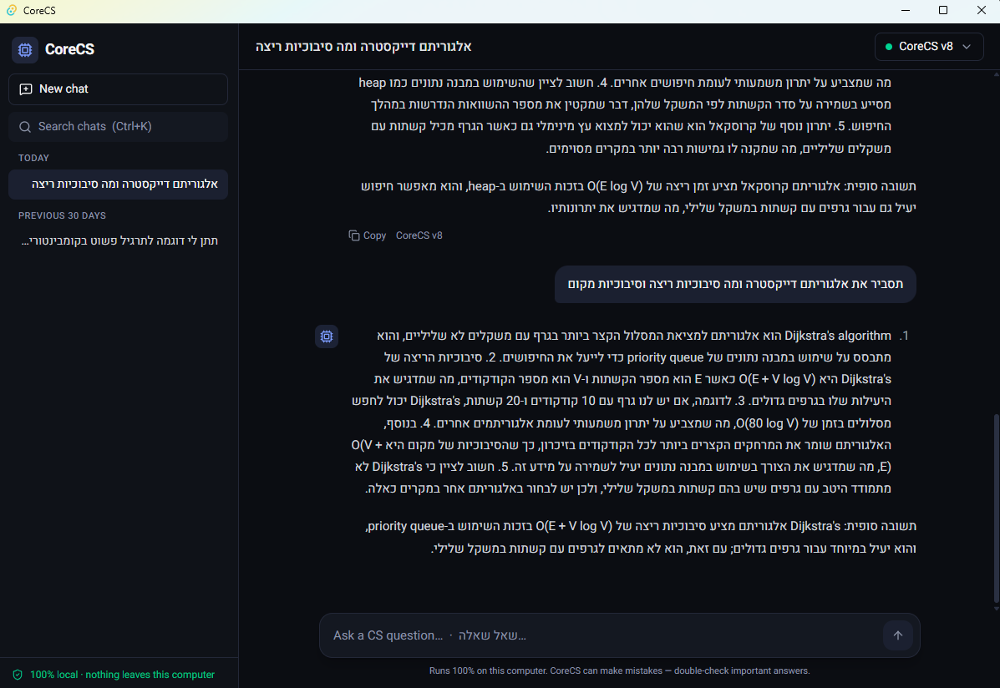
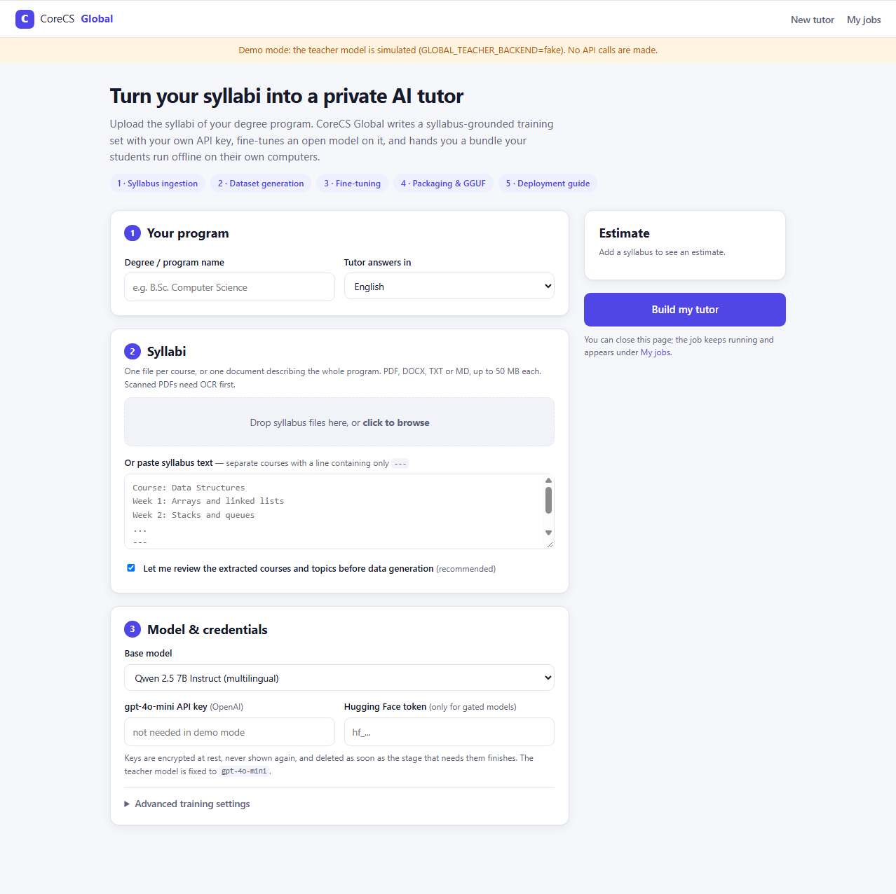

# CoreCS & CoreCS Global

**Offline knowledge distillation of a Hebrew academic CS tutor, from syllabus to student laptop, plus a platform that lets any lecturer do the same for their own program.**

A capstone project in three parts. It starts with 23 B.Sc. Computer Science syllabi, distills
`gpt-4o-mini` into a 7B Hebrew student model with 4-bit QLoRA, and ships that model as a
fully offline desktop tutor. It then generalizes the whole pipeline into a web platform where a
lecturer uploads syllabi and gets back a ready-to-run tutor bundle.

> **Live teacher dashboard:** [CoreCS Global on Vercel](https://knowledgedistillation-web.vercel.app) ·
> **Source:** [github.com/Larryu04/Knowledge_Distillation](https://github.com/Larryu04/Knowledge_Distillation)
>
> The dashboard is a static frontend; it needs the backend running (see [Deployment](GLOBAL/README.md#deployment-vercel-frontend--local-backend-via-ngrok)).

---

## Key results

| | |
|---|---|
| **35% lower loss** | v8 cuts masked loss on the 92-item, 23-domain gold benchmark from 0.8598 to 0.5584 against its own base model (perplexity 2.36 → 1.75) and improves on **92 / 92** items |
| **84.8% win-or-tie** | Double-blind, position-swapped, reference-guided LLM-as-a-Judge: v8 vs. base DictaLM-2.0 = **53 wins / 25 ties / 14 losses** |
| **<2% capacity dilution** | Scaling from 12 to 23 subjects: v8 is the best adapter on all 11 new subjects (+0.078 over v7), while the 12 earlier subjects lose only ~1.9% (0.5529 → 0.5636), keeping ~97% of v7's gain |
| **Edge deployment** | Q4_K_M GGUF (~4.4 GB) runs at **~93 tokens/s** on an RTX 4070 SUPER inside an 18.5 MB native installer, with no network access |

Full methodology, per-domain tables and caveats: [`model_training/README.md`](model_training/README.md) and [`model_training/summary.md`](model_training/summary.md).

<p align="center">
  <picture>
    <source media="(prefers-color-scheme: dark)" srcset="model_training/figures/judge_results_dark.png">
    
  </picture>
</p>

---

## Architecture

```
 23 CS syllabi (Academic College of Ramat Gan)
        │
        ▼  Knowledge distillation: teacher = gpt-4o-mini
 ~27.6K Hebrew Q&A rows  (1,200 per course; numbered rationale + worked example + final answer;
        │                 validated for structure, scope, language, near-duplicates)
        ▼  QLoRA: 4-bit NF4, r=16, frozen embeddings, prompt-masked loss, macro per-domain early stopping
 DictaLM-2.0-instruct 7B  +  LoRA adapter (v8)
        │
        ▼  merge → GGUF → Q4_K_M quantization
 corecs-v8-q4_k_m.gguf   ──►  CoreCS desktop app   (Tauri 2 + React + Rust + llama.cpp, fully offline)
        │
        ▼  generalize every step above into a multi-tenant pipeline
 CoreCS Global  ──  lecturer uploads syllabi + API key  →  ingest → generate → fine-tune → package → deploy guide
                    (Vercel dashboard  ⇄  FastAPI + SQLite job queue + GPU worker)
```

<p align="center">
  <picture>
    <source media="(prefers-color-scheme: dark)" srcset="model_training/figures/pipeline_architecture_dark.png">
    
  </picture>
</p>

---

## Monorepo layout

| Directory | What it is | Stack | Docs |
|---|---|---|---|
| [`model_training/`](model_training/) | The research: dataset generation, QLoRA training, loss evaluation, LLM-as-a-Judge benchmark, figures | Python, PyTorch, Transformers, PEFT, bitsandbytes, OpenAI API | [README](model_training/README.md) |
| [`corecs/`](corecs/) | **CoreCS**: the offline desktop tutor that runs the v8 GGUF | Tauri 2, React 19 + TypeScript, Rust, SQLite, llama.cpp (Vulkan) | [README](corecs/README.md) |
| [`GLOBAL/`](GLOBAL/) | **CoreCS Global**: the lecturer platform that turns any program's syllabi into a tutor bundle | FastAPI, SQLite (WAL) job queue, vanilla-JS UI on Vercel, Python workers | [README](GLOBAL/README.md) |

How they connect:

- `model_training/` produces the adapter. `corecs/scripts/export_gguf.py` merges it into a GGUF the desktop app loads.
- `GLOBAL/` reimplements the generate → train → package steps as resumable pipeline stages, and ships a generic copy of the desktop app in `GLOBAL/runtime/desktop/` inside every bundle.

## Quick start

Each sub-project has its own environment; run commands from inside its directory.

```powershell
# Research pipeline: query the trained tutor, or retrain/re-evaluate
cd model_training
python -m venv .venv; .venv\Scripts\pip install -r requirements.txt
python inference.py

# Desktop app
cd corecs
npm install
powershell -ExecutionPolicy Bypass -File scripts\fetch-llama.ps1
npm run tauri dev

# Lecturer platform (local, no API key or GPU needed in demo mode)
cd GLOBAL
python -m venv .venv; .venv\Scripts\pip install -r requirements.txt
copy .env.example .env          # uncomment GLOBAL_TEACHER_BACKEND=fake for a demo
powershell -ExecutionPolicy Bypass -File scripts\run_platform.ps1   # -> http://127.0.0.1:8000
```

Hardware used throughout: a single RTX 4070 SUPER (12 GB) on Windows 11.

## Screenshots

| CoreCS desktop app | CoreCS Global dashboard |
|---|---|
|  |  |

## Notes

- **Teacher model.** All data generation and judging use `gpt-4o-mini`. GPT-4o appears only as a contestant in the judge benchmark.
- **Scope.** The benchmark comes from the same syllabi as the training data, so it measures syllabus-specific learning. Judge–human agreement has not been measured yet. See the caveats in [`model_training/README.md`](model_training/README.md#scope-and-caveats).
- **Not in git.** Model weights, checkpoints, GGUFs, `.env` files, the llama.cpp toolchain, and platform job data (see [`.gitignore`](.gitignore)).
